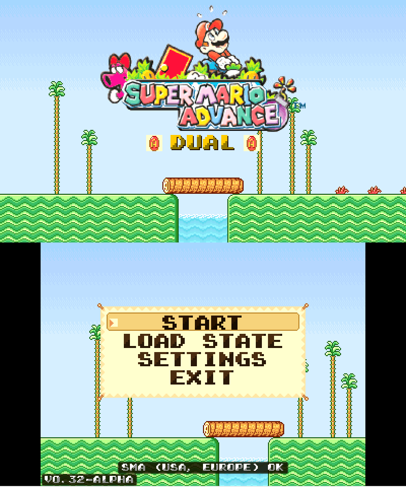
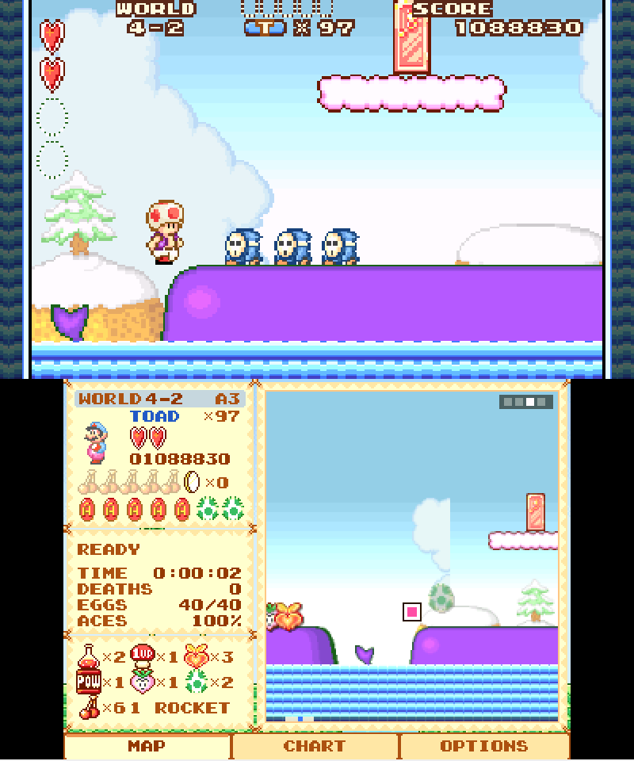
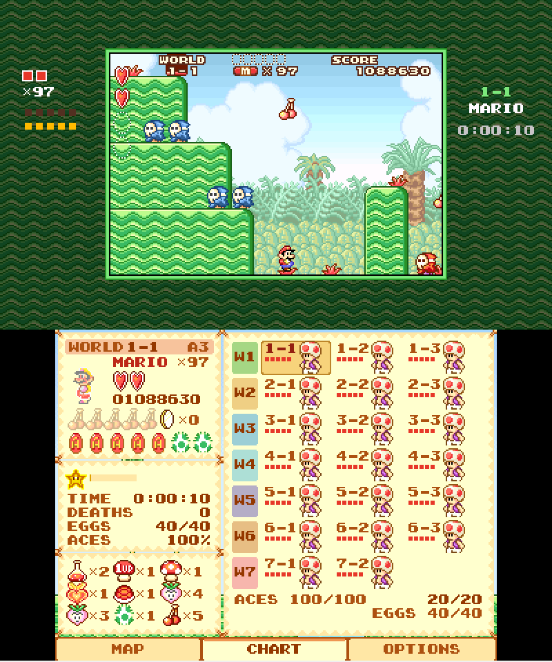
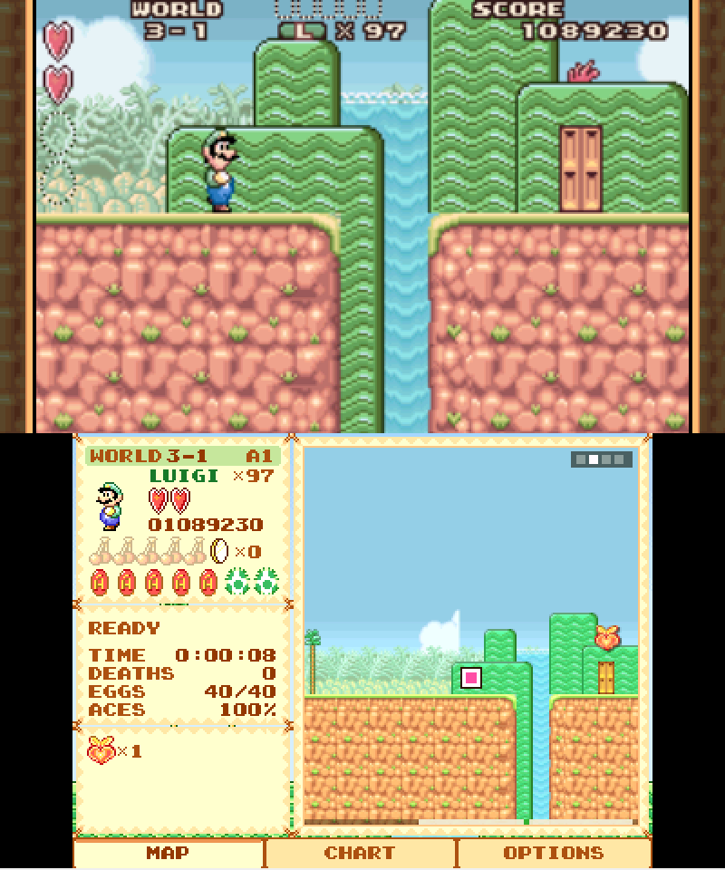
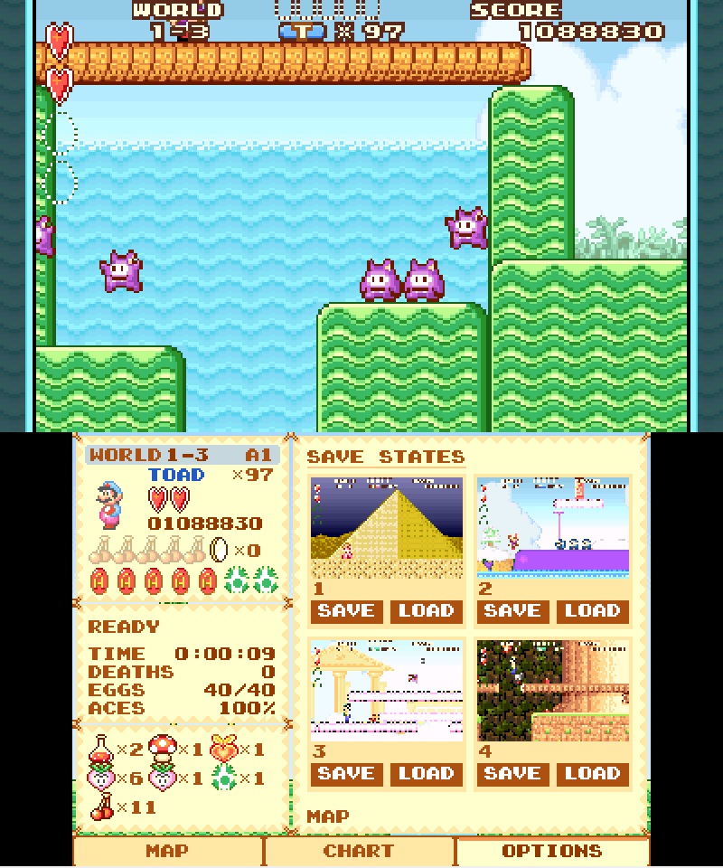
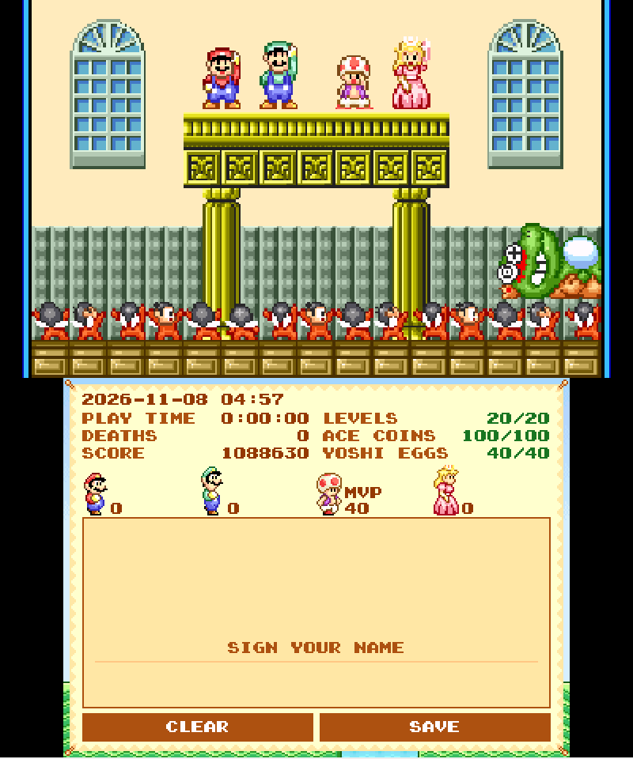
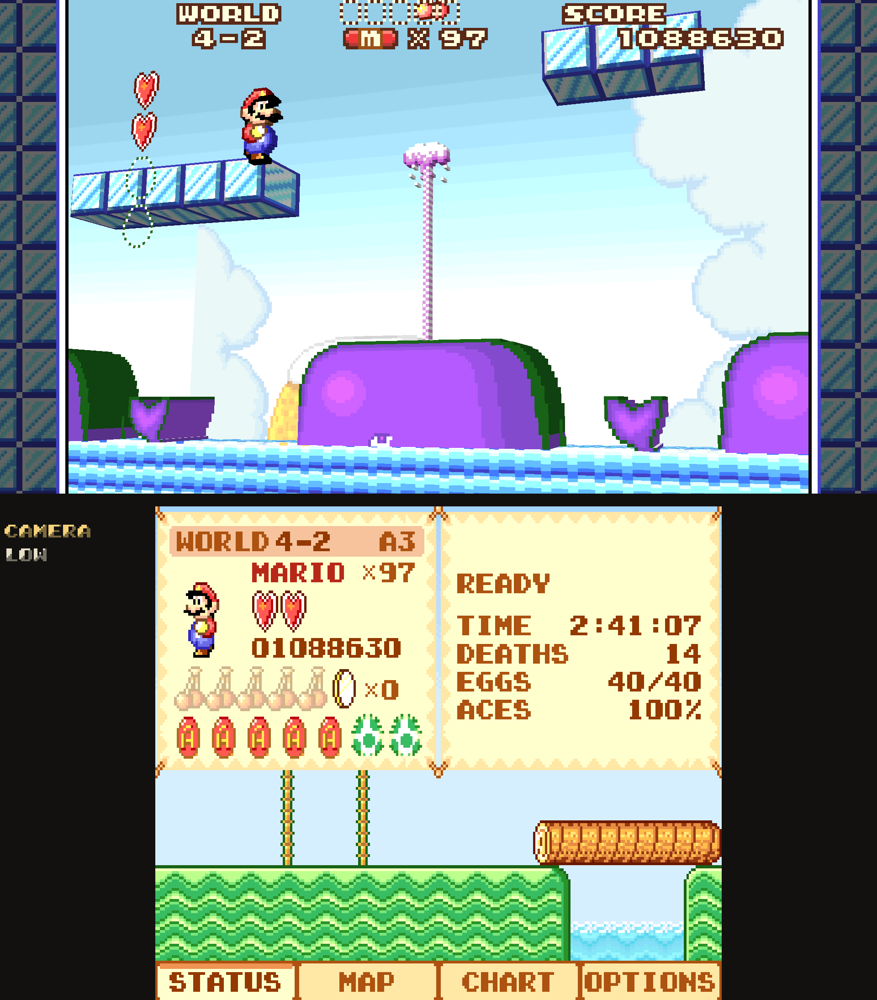
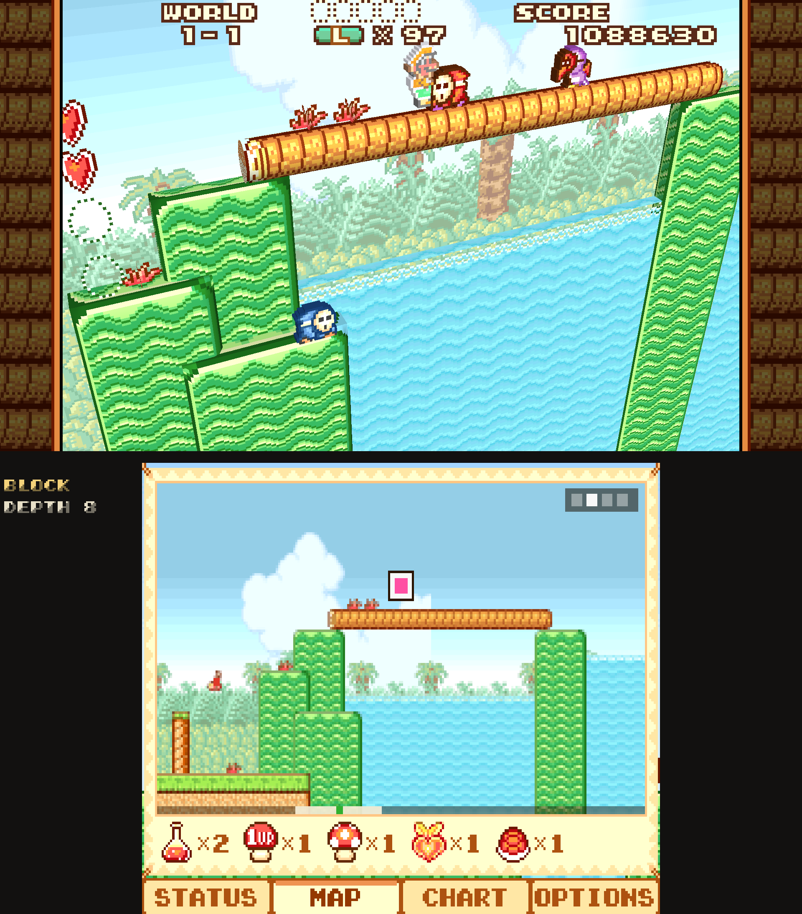
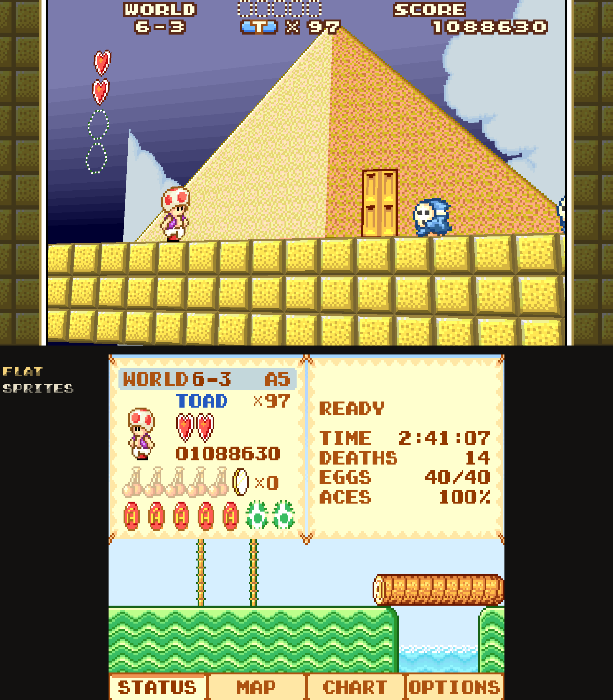
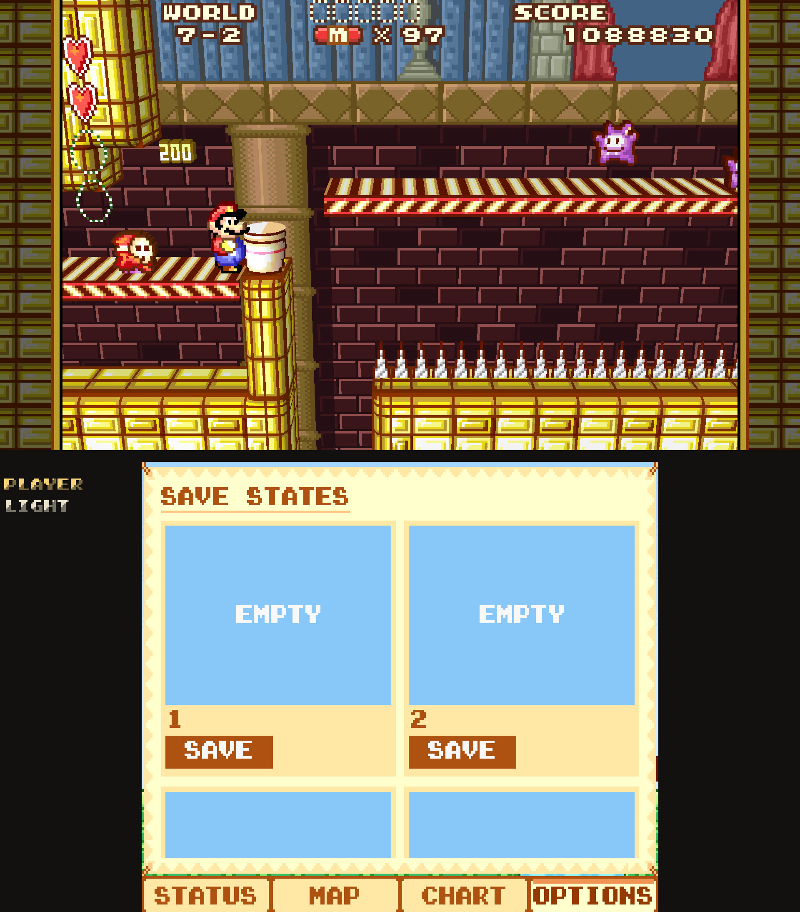

# Super Mario Advance Dual

Super Mario Advance (GBA) on two screens: the game on one, a **Super Mario Advance Link** companion screen on the
other. It shows live status, a map of the area with what's hidden in the grass, a chart of every level's Ace Coins,
and save state shortcuts. It runs as an Android app (Surface Duo, dual-screen handhelds, a second display, or split
screen) and on the New 3DS and New 2DS. There's also **Super Mario Advance Link**, the companion screen on its own,
for playing in RetroArch if you want to keep RetroAchievements support.

**No game files are included.** You supply your own *Super Mario Advance (USA, Europe)* ROM (CRC32 `1E4C6D6A`). The
font, menu art, sprites, title logo and each area's objects are read from it at runtime, and the maps from the
running game.

## Screenshots
Game on the top screen, Link screen below. The first six are the New 3DS port in the Azahar emulator; the last four
are the Android app's experimental 3D view, in the AYN Thor's layout.

<p>




</p>
<p>


</p>
<p>




</p>

## AI-assisted?
Feel free to skip over if you feel strongly about it. Claude's `Opus 5.5` was used for ram mapping and initial coding and `Qwen-3-coding` was used for code review. Code is open-source, feel free to use as a base and human it up.

## Downloads
See [Releases](../../releases). What changed in each version: [CHANGELOG.md](CHANGELOG.md) (Android) and
[native/ctr/README.md](native/ctr/README.md) (3DS).

| File | What it is |
|---|---|
| `Super.Mario.Advance.Dual.<ver>.apk` | Android: emulator + Link screen in one app |
| `Super.Mario.Advance.Link.<ver>.apk` | Android: Link screen only, reading Super Mario Advance running in RetroArch. Works with RetroAchievements (in hardcore mode RetroArch refuses its save state buttons). |
| `Super.Mario.Advance.Dual.3DS.<ver>.SD.root.zip` | New 3DS / New 2DS: extract at the root of the SD card for the `.3dsx` (Homebrew Launcher) and the `.cia` (FBI) |

## Features
- **Link screen:**
  - Status: world, level and area (or SUBSPACE), character, hearts, lives, score, cherries, coins, the level's Ace
    Coins and Yoshi eggs, the star, stopwatch and Subspace timers, play time, deaths and levels cleared.
  - Map of the whole area in the game's own tiles and background. It follows you; tap for four zooms, drag to look
    around. Shows what's hidden in the grass, every Ace Coin (red where you still need it), mushroom spots, the key,
    the crystal ball, the exit and the boss.
  - Chart of all 20 levels: Ace Coins, who cleared each one, warped levels and the totals.
  - Cards for Bonus Chance and Mario Bros. Classic, and an ending card with the run's stats to sign with your finger.
- **Save states:** 4 slots with screenshots, plus quick save/load to slot 1 and an auto state on exit.
- **Screens:**
  - Surface Duo hinge, a second display, split screen (side by side / top and bottom with a hinge gap, swappable),
    or one screen with a side panel or overlay.
  - 3:2 borders themed from the level's own blocks, with hearts, lives, cherries, Ace Coins, level, character and
    play time in them.
- **Controls:** Touch pad support and controller support with rebinding, turbo and fast-forward. Default hotkeys:
  L2 / R2 save / load slot 1, L3 next 3D camera, R3 2D / 3D.
- **NO SLOWDOWN:** the emulator's overclock (CPU instructions at half their cycles), on by default.
- **Menus from your ROM:** the launcher and pause menu use the game's font, title backdrop and pause panel, captured
  on first start.
- **Launcher music:** "Curtain Call", synthesized menu music.
- **Experimental 3D view:** the level rebuilt in 3D every frame from the live tile map, with the game's parallax
  layers behind and the HUD flat in front. Four cameras (Low, Tilt, Diorama, Far), block depth, back wall,
  background, player light, thick or round sprites, and 3D borders. Super Mario Advance Link has it in a tab of its
  own, off by default.
- **Playtest codes:** hidden behind the Konami code on the launcher, off by default.
- **New 3DS / New 2DS:** the same core, Link screen and menus, written in C: the game on the top screen, Link on the
  touch screen. Everything above but the 3D view and the Android screen modes. See
  [native/ctr/README.md](native/ctr/README.md).

Dual and Link side by side: [docs/features.html](docs/features.html).

## Source layout
| Path | |
|---|---|
| `app/` | Android app (Java, no AndroidX). `assets/menu` = launcher/pause menu, `assets/link` = Link screen (HTML/JS) |
| `native/` | mGBA frontend (`gbacore.c`), JNI layer, play-stat tracker, first-start capture, desktop test driver (`drive.c`), `mgba-dual.patch`. `ctr/` = the New 3DS port (libctru, C) |
| `linkapp/` | Super Mario Advance Link for Android (WebView + RetroArch network commands) |
| `tools/` | build scripts, toolchain setup, JNI and log headers |
| `tests/` | page, menu, 3D view, input and RetroArch tests, and the release pictures (they need your ROM and local dumps; not included) |
| `docs/` | Dual against Link feature checklist, screenshots |
| `out/` | `android/libsmadual.so`, prebuilt, so the APK builds without rebuilding the core |

## Building
Android (no NDK needed; see `tools/setup_toolchain.sh`):
```
bash tools/setup_toolchain.sh      # bionic headers, stub libs, compiler-rt, android.jar, mGBA @ 7a12d6d + patch
bash tools/build_apk.sh            # -> out/Super Mario Advance Dual <ver>.apk
bash tools/build_link_apk.sh       # -> out/Super Mario Advance Link <ver>.apk (no native code)
```
Needs clang, lld, llvm, git, python3, aapt, zipalign, apksigner, dalvik-exchange and openjdk-17. `setup_toolchain.sh`
fetches android.jar (API 33) from github.com/Sable/android-platforms. The signing keystores are not in the repo:
`build_apk.sh` creates a new one with a random password if `tools/smadual.keystore` is missing (`build_link_apk.sh`
the same for `tools/smalink.keystore`), with the password in a `.pass` file beside it. Builds signed with a different
key can't update an installed copy.

New 3DS (devkitPro's 3ds-dev: devkitARM r68, libctru 2.7.0, citro3d 1.7.1; and ImageMagick):
```
export DEVKITPRO=/opt/devkitpro DEVKITARM=/opt/devkitpro/devkitARM
make -C native/ctr MGBA=$HOME/src/mgba OUT=$HOME/sma3d/ctr      # -> $OUT/Super Mario Advance Dual 3DS.3dsx
OUT=$HOME/sma3d/ctr bash native/ctr/cia/build_cia.sh            # -> $OUT/Super Mario Advance Dual 3DS.cia
```
`MGBA` is the patched mGBA that `setup_toolchain.sh` checks out. The `.cia` also needs makerom (3DSGuy/Project_CTR),
bannertool (carstene1ns/3ds-bannertool) and Pillow. The core's profile in `native/ctr/pgo/` only applies with mGBA at
`$HOME/src/mgba`.

## Credits and licences
This project is licensed under the **GNU General Public License v2.0 or later** (see `LICENSE`).
If you do use parts of it in your project, please credit me as a "playtester".
The release builds include:
- **mGBA** (MPL-2.0), github.com/libretro/mgba, commit `7a12d6d4`, with `native/mgba-dual.patch` (the NO SLOWDOWN
  overclock, a vblank-wait counter, a write-trace hook for desktop builds). Its licence ships in the Dual APK and
  the 3DS zip.
- **compiler-rt builtins** (Apache-2.0 with LLVM exception), github.com/llvm/llvm-project, unmodified, commit
  `e5fc6fb5` (Dual APK).
- **libctru** 2.7.0 and **citro3d** 1.7.1 (zlib), github.com/devkitPro, unmodified (3DS).
- **newlib** 4.6.0 (BSD-style licences), the C library as built by devkitARM r68 (3DS).

RAM and ROM addresses were found by tracing and poking the running game in the desktop driver (`native/drive.c`).
A few are from Data Crystal's Super Mario Advance RAM map, and the object types follow Xkeeper0/smb2's SMB2
disassembly.
Super Mario Advance and Mario are trademarks of Nintendo. This is an unofficial fan project and is not affiliated
with Nintendo.

## RAM / ROM used (Super Mario Advance USA, Europe)
`030019B0` game mode (2 menus, 3 SMB2, 4 Mario Bros. Classic), `03001991` / `03001992` sub-mode / state (mode 3,
1, 1 = playing), `03001160` level (0-19 = 1-1 to 7-2), `030019FE` area, `03001161` lives, `0300114C` score / 10,
`03001C70` character (0 Mario, 1 Peach, 2 Toad, 3 Luigi), `03001C76` health (`0F`, `1F`, `2F`, `3F` = 1-4 hearts),
`03001C77` mushrooms taken, `03001A07` / `03001A26` coins / cherries, `03001C88` / `03001CAC` / `03001CCF` star /
stopwatch / Subspace timers, `03001150-5C` Ace Coins (5 bits per level), `0300115D-5F` levels cleared (a bit per
level), `03001140-44` Yoshi eggs (2 bits per level), `03001148-4B` levels cleared per character, `03001C4A` /
`03001C4E` player X / Y, `03001168` camera X, `03001CF0` object slots (`0x70` each), `02000000` the decoded area
(u16 metatiles, pages of 15 x 16), `02002B20` sky colours.
ROM (file offsets): font `0x2F3D7C` (48 tiles), metatile tiles `0x3400E0`, object lists `0x364D84` (20 levels x 11
areas of type, x, y), title logo `0x32DB10`, player sprites from `0x2EAB5C` (`0x2000` per character).
Everything the apps read, and how each address was found: [RAM-MAP.md](RAM-MAP.md).
