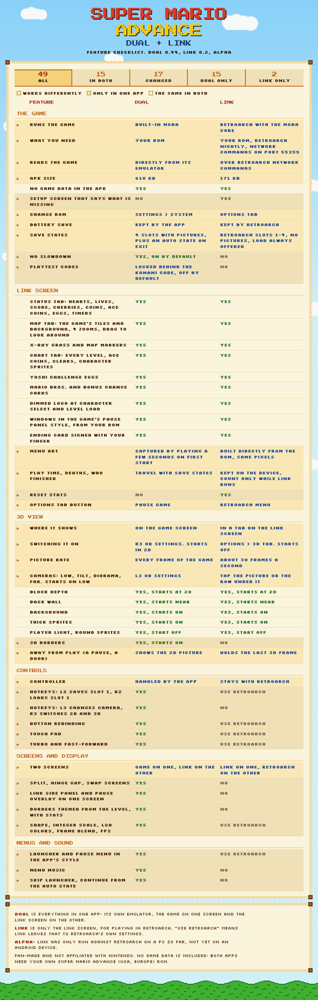

# Super Mario Advance Dual

Android apps for playing Super Mario Advance (USA, Europe) on two screens: the game on one, and a companion screen on the other with live status, a map of the area you're in and a chart of every level. Dual also has an optional 3D view of the levels. Fan-made and not affiliated with Nintendo.

| App | What it is |
|---|---|
| **Super Mario Advance Dual** | Everything in one APK: its own emulator (mGBA), the game on one screen, the Link screen on the other, and the 3D view on the game's screen. |
| **Super Mario Advance Link** | Only the Link screen, for playing in RetroArch on the same device. It reads the game over RetroArch's network commands and has a 3D tab of its own. See [linkapp/README.md](linkapp/README.md). |

Download the APKs from [Releases](https://github.com/Nihilspire/SMBA-Dual-Screen-Mods/releases). What changed in each version: [CHANGELOG.md](CHANGELOG.md).

**Nothing from the game ships.** Both apps need your own ROM of Super Mario Advance (USA, Europe), CRC32 `1E4C6D6A`. The font, the menu graphics and every picture on the Link screen come from that ROM and the running game.



The same list with filters: [docs/features.html](docs/features.html), to open in a browser.

## Getting started
**Dual:** install it, start it and choose your ROM. The first start (and the first after choosing a new ROM) plays the game for about a second in the background, with an empty throwaway save, to capture the menu art. Your own save is never opened. The game's battery save is kept in the app's files (`game.sav`) and written when you pause, quit or leave the app.

**Link:**
1. Install RetroArch Nightly.
2. In RetroArch: Settings > Network > Network Commands ON, Network Command Port 55355.
3. Load the game with the mGBA core.
4. Start Link on the second screen, tap CHOOSE ROM and pick the same ROM file. You only do this once.

## Screens
| Setup | What happens |
|---|---|
| Surface Duo, app spanned | Game on one screen, Link on the other, split at the hinge. |
| Second display (AYN Thor style, cast/HDMI) | Link goes to the second display as a Presentation. |
| One screen | Game in 3:2 with borders themed from the level's own blocks; hearts, lives, cherries, Ace Coins, level, character and play time in the borders. Link via Pause > LINK SCREEN or Settings > LINK SIDE PANEL. |
| Anything else | Settings > SCREENS > SPLIT: SIDE BY SIDE / TOP + BOTTOM (+ HINGE GAP), SWAP SCREENS. |

## Controls
Touch pad (auto / on / off, opacity), controllers with rebinding (Settings > CONTROLS > CONTROLLER BUTTONS; L and R
are bindable too), **SELECT+START** or Back opens the pause menu, turbo, fast-forward (TAB on a keyboard; no pad button until you bind one).

| Hotkey (default) | Does |
|---|---|
| L2 | Save to state slot 1, the menu's SLOT 1, without asking |
| R2 | Load state slot 1 |
| L3 (left stick click) | Next 3D camera |
| R3 (right stick click) | Switch between 2D and 3D |

Analog triggers count as L2 and R2 past 60% of the way, whether the pad reports them as axes, keys or both.

## The Link screen
- **Status:** world and level, area (or SUBSPACE), your character, hearts at the meter's real size, lives, score, cherries toward a Starman, coins, the level's five Ace Coins and Yoshi eggs, the star, stopwatch and Subspace timers, play time, deaths, levels cleared and the Ace Coin total. The status line says GAME OVER, OUCH or POWER JUMP when they apply.
- **Map:** the whole area in the game's own tiles, over the game's own background. It follows you like a game camera; tap it to step through four zooms and drag to look around. Markers show what's hidden in the grass (with the game's own item icons), every Ace Coin in the area (red where you still need it), mushroom spots, the key, the crystal ball, the exit, the boss and the Yoshi Challenge's eggs. A line under the map lists what's hidden, Ace Coins left first.
- **Chart:** all 20 levels with their five Ace Coins, who cleared each one (that character's sprite), warped levels and the totals.
- **Options:** save states with pictures, map options and the marker legend.
- **Other screens:** a Bonus Chance card, the Mario Bros. Classic scoreboard, the game's logo (dimmed) on its menus and at character select, and through the ending, a card with the run's stats to sign with your finger.

## 3D view (experimental)
Settings > 3D VIEW, or R3. Each 8x8 cell of the level is built from the live tile map and the level data: ground and blocks become blocks, scenery like grass and vines becomes cut-outs, and hills, clouds, jars, logs, water and pyramids get shapes of their own. The game's parallax layers and its sky gradient sit behind, and the HUD stays flat in front. The view is 3D only during play; the title, menus, character select, pause and transitions show the normal picture.

| Option | Default | Choices |
|---|---|---|
| Camera (L3, or F3 on a keyboard) | LOW | LOW, TILT, DIORAMA, FAR |
| Block depth (Page Up / Page Down) | 20 | 4 to 48 |
| Back wall | NEAR | NEAR, DEEP, OFF. It only changes the picture in a few places, 5-3's cave the most. |
| Background | ON | ON, OFF |
| Player light | OFF | ON, OFF |
| Thick sprites | ON | ON, OFF |
| Round sprites | OFF | ON, OFF |
| 3D borders | ON | ON, OFF |

`Scene3D.java` builds the geometry (no Android code, so it also runs on the desktop) and `Renderer3D.java` draws it.

## Menus and settings
The launcher and pause menu are drawn in the game's font, with the title screen's backdrop, the game's pause panel and its arrow, all from the first-start capture. If the capture fails, or SETTINGS > SYSTEM > MENU GRAPHICS is set to DRAWN, a drawn look-alike is used; REBUILD MENU GRAPHICS captures again. The launcher plays "Curtain Call", an original shuffle synthesised in WebAudio.
- **Save states:** 4 slots with screenshots, plus an auto state on exit.
- **Settings:** DISPLAY (3:2 or stretch, integer scale, GBA LCD colours, frame blend, borders, FPS), SCREENS, 3D VIEW, CONTROLS, SOUND, GAMEPLAY (NO SLOWDOWN, on by default) and SYSTEM.
- **Playtest codes:** up up down down left right left right B A on the launcher shows them (again to hide them): infinite life and lives, refill life, Starman, stopwatch, 4 cherries, +5 lives, set play time and warp to any level. They're off by default.

## How it's made
- **Emulator:** mGBA, libretro fork (MPL-2.0, github.com/libretro/mgba @ 7a12d6d) plus `native/mgba-dual.patch` (NO SLOWDOWN overclock, a vblank-wait counter, and a write-trace hook for desktop builds). mGBA's `libretro.c` is compiled into `native/gbacore.c` (its `core` is static), statically linked into `libsmadual.so` with the JNI layer (`native/gbajni.c`), the play-stat tracker (`native/smatrack.c`) and the first-start menu capture (`native/extract.c`). Built-in HLE BIOS: no BIOS file needed.
- **Base:** built on Mario 2 Dual 0.1 (itself on Metroid Dual 0.45): the same frontend, screens, controls, pacing and menus, with the NES core swapped for a GBA one.
- **Link:** a Java app with no native code, reading RetroArch's memory over its network commands. See [linkapp/README.md](linkapp/README.md).
- **RAM / ROM map:** everything the apps read from the game is in [RAM-MAP.md](RAM-MAP.md).

## 3DS
Super Mario Advance Dual 3DS (0.32-alpha), for **New 3DS and New 2DS only**: this core on the top screen and the Link screen in C on the touch screen, with everything here except the 3D view and the Android screen modes. Download the `(SD root)` zip from [Releases](https://github.com/Nihilspire/SMBA-Dual-Screen-Mods/releases), extract it at the root of the SD card and put your ROM in `3ds/sma-dual/`. Source, how to run it and what's been tested: [native/ctr/README.md](native/ctr/README.md). Its changes to shared
code: `gbacore.c` and `extract.c` gain `gba_load_mem`, `gba_skip_next_render`, `gba_enable_layer` and `sma_extract_tick`, unused here (`gbacore.c`'s threaded video, GPU output and picture hand-over are compiled for the 3DS only); `mgba-dual.patch` takes the overclock's sums out of the main loop when it's off, which leaves the emulation byte-identical (RAM, VRAM and pictures, 400 frames with it off and on). The idle loop that halves a frame's cost there (RAM-MAP.md) is 3DS only.

## Build
```
bash tools/setup_toolchain.sh      # bionic headers + stub libs + compiler-rt builtins, android.jar, mGBA @ 7a12d6d + patch
bash tools/build_apk.sh            # -> out/Super Mario Advance Dual <ver>.apk
bash tools/build_link_apk.sh       # -> out/Super Mario Advance Link <ver>.apk (no native code, no setup step)
```
apt: clang lld llvm aapt zipalign apksigner dalvik-exchange openjdk-17-jdk-headless.
`out/android/libsmadual.so` is included so the core doesn't have to be rebuilt. The signing keys (`tools/smadual.keystore`, `tools/smalink.keystore`) and their passwords (one line each in a `.pass` file beside the key) aren't in git. The build makes a new key with a random password if there is none, but an APK signed with a new key can't update one signed with the old, so keep them safe.

## Test
- `make -C native TARGET=host MGBA=... host` -> `out/host/drive rom script [savedir]`
  (run/tap/shot/dump/save/load/peek/poke/rec/trace/rtrace/trk/trkreset/oc/lag/extract/layer/clock). `trk` prints the Dual tracker. `layer id 0|1` leaves a layer out of the picture (4 is the sprites); `clock N` times N frames of the core. `extract file` runs the first-start
  capture on a freshly loaded ROM (use an empty savedir). `dump` = IWRAM | EWRAM | IO | PAL | VRAM | OAM.
  `trace lo hi max file` logs every CPU write in a range with PC and LR; `rec N buttons file` appends IWRAM per frame.
- `tests/linktest.py rom dump out [js]`: Link page in headless Chromium with a mock Native fed from a dump.
- `tests/menutest.py rom thumb.png outdir [kit.bin|-] [standin]`: launcher / pause / settings, with a capture
  from `drive ... extract`; `standin` swaps every ROM piece (and the font) for plain stand-ins for preview images.
- `tests/scene3d/`: `build.sh`, then `SceneDump rom dump out.s3d` and `shot.py out.png out.s3d [preset] [standin]`
  renders the 3D view with Renderer3D's own shaders in headless Chromium (WebGL).
- `tests/ra/`, `tests/mock_ra.py`: Link's transport, tracker, kit and page; see [linkapp/README.md](linkapp/README.md).
- `tests/input/`: `build.sh`, then `java -cp tests/input/out com.jack.smadual.InputCheck binds.json` (default hotkeys, saved bindings, triggers) and
  `check_defaults.py rom kit dump binds.json outdir` (every default in the source, the Konami lock in the menu, Link's 3D tab).
- `tests/showcase/`: the release pictures. `spots.py WORK` plays to each spot on the driver (flying along the top so the game really scrolls and spawns what's
  there; `SHOW_DIR` picks the folder), `render3d.py WORK OUT` renders each in every camera and the 3D menu's options, `linkshots.py WORK OUT` Link's pictures with
  the game on top, and `dualscreen.py WORK OUT [gifs|stills]` the GIFs and stills in the Thor's layout (run `build.sh` first; `showcase_clips.py` lists what they show).

## Licence
mGBA is MPL-2.0. Its licence text ships in the APK as `assets/licenses/mGBA-MPL-2.0.txt`, and SETTINGS > SYSTEM names it. Its source is mGBA at the commit above plus `native/mgba-dual.patch`, which `tools/setup_toolchain.sh` fetches and applies.
